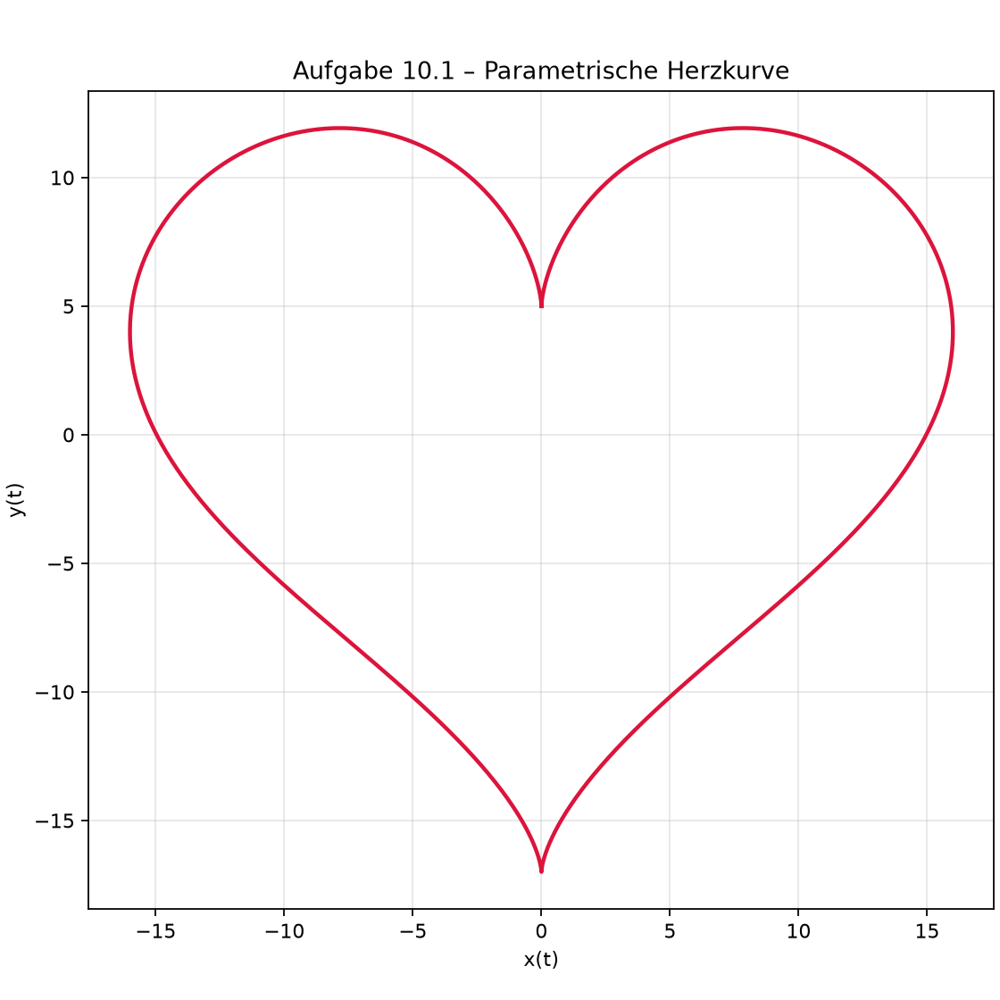

# Aufgabe 10.1 – Isolierte Umgebung mit uv

Quelle: [Gregor Ehrensperger, Industrial Data Science, Exercise 10.1](https://noxthot.github.io/ws26_industrial_datascience_manuscript/1_act1/6_self_study_session1.html), abgerufen 25.10.2026.
Dies ist eine eigene Lösung und Zusammenfassung, keine vollständige Kopie der Aufgabe.

## Ziel und Einrichtung

uv verwaltet Python-Versionen, projektlokale Umgebungen und Abhängigkeiten.
Die Isolation verhindert, dass Paketänderungen dieses Projekts andere Projekte verändern.
`pyproject.toml` beschreibt die direkten Abhängigkeiten, `uv.lock` deren aufgelöste
Versionen einschließlich transitiver Pakete. `.venv` enthält die tatsächlich installierten Pakete.

uv wurde aus dem offiziellen Windows-Release projektlokal unter `.tools/uv/`
bereitgestellt. Das Projekt wurde durch seine Konfigurationsdateien initialisiert;
`uv sync` erstellt daraus die virtuelle Umgebung. Ein zusätzliches `uv init` würde
die bereits vorhandene Projektkonfiguration nicht sinnvoll erneut initialisieren.
Für ein neues, leeres Lernprojekt entsprechen dem folgende Schritte:

```powershell
uv init --bare --python 3.12
uv venv
uv add numpy matplotlib
```

Hier reproduziert man die bereits eingerichtete Lösung mit:

```powershell
.\.tools\uv\uv.exe sync --locked
.\.tools\uv\uv.exe run --locked python sessions/ch10/aufgabe_10_1.py
```

## Mathematische Idee

Die vorgegebene Funktion ist eine parametrisierte ebene Kurve:

\[
x(t)=16\sin^3(t),\qquad
y(t)=13\cos(t)-5\cos(2t)-2\cos(3t)-\cos(4t).
\]

Mit `numpy.linspace(0, 2*pi, 1001)` wird eine vollständige Periode einschließlich
beider Endpunkte abgetastet. `ax.plot(x, y)` verbindet diese Punkte in Parameterreihenfolge.
Die gleiche Skalierung beider Achsen bewahrt die Form. Die Kurve ist ein Herz.
Die 1001 Punkte sind eine diskrete Näherung der kontinuierlichen Kurve.

## Ergebnis und Kontrolle



Unabhängig nachrechenbare Punkte:

| t | x | y |
|---|---:|---:|
| 0 | 0 | 5 |
| pi/2 | 16 | 4 |
| pi | 0 | -17 |
| 3*pi/2 | -16 | 4 |
| 2*pi | 0 | 5 |

Die Kurve ist geschlossen und spiegelsymmetrisch zur y-Achse. Tests prüfen diese
Eigenschaften mit Gleitkommatoleranz, endliche Koordinaten, ungültige Punktzahlen
und einen lesbaren PNG-Export. Das Skript verwendet den Agg-Backend und speichert
die Abbildung auch ohne grafische Sitzung; es öffnet kein Plotfenster.
Den tatsächlich ausgeführten Prüfstand dokumentiert `docs/STATUS.md`.

## Selbst erklären können

1. Warum schützt `.venv` vor Paketkonflikten zwischen Projekten?
2. Was unterscheidet `pyproject.toml`, `uv.lock` und `.venv`?
3. Warum wird x gegen y und nicht t gegen y geplottet?
4. Warum sind gleiche Achsenskalierung und eine vollständige Periode sinnvoll?
